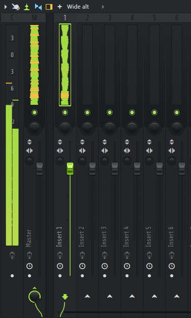
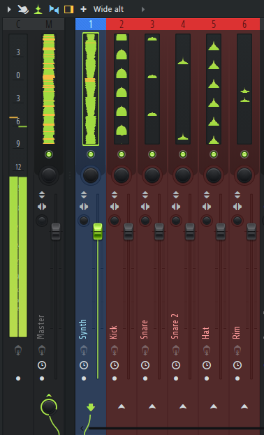
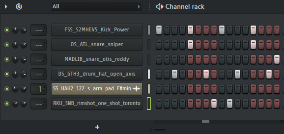
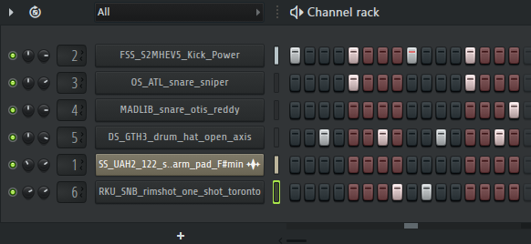
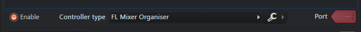
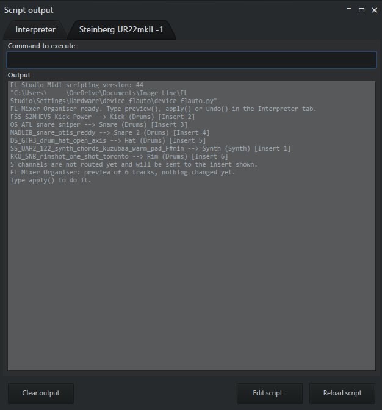

# FL Mixer Organiser


Clean up a messy FL Studio mixer in one step. The script reads the channel names, then names, colour-codes and routes the mixer tracks: `FSS_S2MHEV5_Kick_Power` becomes a red `Kick` track on its own insert.

| Before | After `apply()` |
|---|---|
|  |  |
|  |  |

Top: the mixer. Bottom: the channel rack, where the box left of each name is the mixer insert it plays through (`---` means none).

## Contents

- [Overview](#overview)
- [Features](#features)
- [Tech stack](#tech-stack)
- [Project structure](#project-structure)
- [Installation](#installation)
- [Usage](#usage)
- [How it works](#how-it-works)
- [Testing](#testing)
- [Development process](#development-process)
- [Known limitations](#known-limitations)
- [License](#license)

## Overview

FL Studio projects fill up with channel names like `FSS_S2MHEV5_Kick_Power`. Stem export needs every sound on its own readable mixer track, and doing that by hand takes time on every project. This script does it with one command.

Tested on 50+ of my own projects (10–12 channels each): 95% of channels got the right name and category.

## Features

- **Naming.** Turns each channel name into a clean track name (`OS_ATL_snare_sniper` → `Snare`). Duplicates are numbered: `Snare`, `Snare 2`.
- **Colour-coding.** Colours each track by category: Drums red, Bass orange, Synth blue, Vocals purple, FX yellow, unknown grey.
- **Routing.** Sends channels that are not on an insert yet to the next empty insert. Inserts that already hold effects are left alone.
- **Preview, apply, undo.** Shows every change before making it, and restores the old routing, names and colours on request.
- **Safety checks.** Never runs on its own, refuses to apply without a fresh preview, and never applies twice before an undo.

## Tech stack

- **Python 3.13**, FL Studio's embedded interpreter
- **FL Studio Python scripting API** (MIDI controller scripting, API version 44): `channels`, `mixer`, `plugins`, `utils`
- **pytest** for unit tests

## Project structure

```
fl-studio-mixer-organiser/
├── categorise.py           # keyword rules, categorise(), make_plan(); no FL imports
├── device_flauto.py        # FL Studio script: preview(), apply(), undo()
├── tests/
│   ├── test_categorise.py  # naming rules
│   └── test_planner.py     # insert assignment and routing plan
├── docs/
│   └── images/             # screenshots used in this README
├── pytest.ini              # puts the repo root on the test path
├── LICENSE
└── README.md
```

## Installation

1. Download the zip from the [latest release](https://github.com/beyjanbolat/fl-studio-mixer-organiser/releases/latest) and copy the two files inside it (`device_flauto.py` and `categorise.py`) into a new folder under `Documents\Image-Line\FL Studio\Settings\Hardware\`.
2. Restart FL Studio.
3. In **Options > MIDI settings**, pick a MIDI input and set its **Controller type** to **FL Mixer Organiser**.



## Usage

Open **View > Script output** and go to the **Interpreter** tab. Type one of three commands:

| Command | What it does |
|---|---|
| `preview()` | Prints what would change. Changes nothing. |
| `apply()` | Does exactly what the preview showed. Saves the old state first. |
| `undo()` | Puts the routing, names and colours back. |

`preview()` prints one line per channel, `original name --> new name (category) [Insert n]`, and says how many channels are not routed yet:

 Kick (Drums) [Insert 2]" width="560">

Channel names in the channel rack and effects on the mixer are never changed.

## How it works

### Architecture

The code is split into two layers:

- **`categorise.py`**: the logic. Keyword rules, `categorise()` (raw name → clean name and category) and `make_plan()` (which insert each channel gets). It has no FL imports, so it is fully unit-tested outside FL.
- **`device_flauto.py`**: the FL Studio integration. It reads the project through the API, passes the names to `make_plan()`, and writes the result back.

### Matching rules

- **Keywords as data.** A dict maps each category to a list of keywords. Adding a keyword is one entry, no new logic. Matching ignores case; the clean name is the keyword as spelled in the dict.
- **First match wins.** Categories are checked in order: Drums, Vocals, FX, Bass, Synth. So `808 Kick` is Drums, not Bass, and `vox lead 2` is Vocals, not Synth (`Lead` is a synth keyword).
- **Word-start rule.** A keyword only counts where a word starts: at the beginning, after a non-letter (`_`, space, digit), or at a capital after a lowercase letter (`CleanHat`).

| Raw name | Clean name | Category |
|---|---|---|
| `ThaiKick_01_SP` | `Kick` | Drums |
| `CleanHat_01_SP` | `Hat` | Drums |
| `HAT LOOP 91 BPM` | `Hat` | Drums |
| `Hihat 1` | `Hihat` | Drums |
| `PL_TS_Snare_One` | `Snare` | Drums |
| `Serum #2` | `Serum` | Synth |
| `vox lead 2` | `Vox` | Vocals |
| `Riser` | `Riser` | FX |
| `Chat` | `Chat` | unknown |

A name that matches nothing keeps its original name and goes grey. Try the logic without FL:

```
python -c "from categorise import categorise; print(categorise('ThaiKick_01_SP'))"
```

```
('Kick', 'Drums')
```

### FL Studio API calls

| Module | Calls |
|---|---|
| `channels` | `channelCount`, `getChannelName`, `getChannelType`, `getTargetFxTrack`, `setTargetFxTrack` |
| `mixer` | `trackCount`, `getTrackInfo`, `getTrackName`, `setTrackName`, `getTrackColor`, `setTrackColor` |
| `plugins` | `isValid` (to find inserts that already hold effects) |
| `utils` | `RGBToColor` |

## Testing

```
pip install pytest
pytest
```

26 unit tests: `tests/test_categorise.py` covers the naming rules, `tests/test_planner.py` covers which insert each channel gets. On top of that, the script was run on 50+ real FL Studio projects (10–12 channels each) with 95% renaming and category accuracy.

## Development process

Built in small steps, each one checked in FL before the next, working from the Image-Line documentation and fixing things where FL behaved differently from it.

**Naming logic, from real data**

1. Took a random sample of 800 file names from my own sample library and counted the most common words. That gave the drum, vocal and FX keywords.
2. The first version used plain substring matching, which matched `hat` inside `Chat`. Replaced it with the word-start rule.
3. Re-running on the sample showed the new rule broke compound names: `Hihat 1` and `Openhat` came back `unknown`. Added them as their own keywords.
4. Order mattered: with `Hat` before `OpenHat`, `OpenHat` returned `Hat`. Longer keywords now come first.

**FL Studio integration**

5. A first script only printed the channel count. That proved the script loads (scripting API version 44).
6. Tried a Piano Roll script first, because it has a Run button and a dialog. It cannot `import channels` and cannot write files, so that was a dead end. Switched to a controller script.
7. The docs give colours as `0x--BBGGRR`. Hand-typed hex came out wrong, and values read back from FL came back negative, with an alpha byte. Switched to `utils.RGBToColor(r, g, b)`.
8. Imported `categorise.py` from the same folder; it ran unchanged inside FL. Keeping the logic free of FL imports paid off here.
9. Ran a read-only loop over real channels and printed the result before writing anything.
10. The first `preview()` crashed: `mixer.getTrackInfo` returned 500 for the last insert, not the real number of inserts. The script now counts inserts from `mixer.trackCount()`.

**Safety and ease of use**

11. The first trigger was a MIDI note. Playing a drum pad could set it off by accident, and a second run overwrote the undo state. Replaced it with three commands typed in FL's Interpreter tab: `preview()`, `apply()`, `undo()`.
12. Added the safety rules: preview before apply, apply only if the project still matches the preview, never apply twice, save the old state before changing anything.

**Lessons learned:** test against real data, not only hand-picked examples, and check every API fact in the running program. The docs were right about which calls exist, but colours and track counts only made sense once I printed what FL actually returned.

## Known limitations

- Only the first occurrence of a keyword is checked: `Chat Hat` returns `unknown`.
- A keyword glued mid-word in lowercase is not found: `bigkick` returns `unknown`.
- Misspellings match only if listed as keywords (for example `Kik`).
- Only the name is used, not the plugin or sample behind the channel.
- If several channels already feed the same mixer track, the first one names it.
- A bus with no plugins that other tracks send into can still be picked as "empty".
- Undo is kept in memory: it is lost when FL or the script restarts.
- Undo puts track colours back to a dark grey, not FL's exact default. FL reports the same value for the default and for a colour you set yourself.
- If there are more channels than free inserts, the extra channels are left out. `preview()` says how many.
- The script needs a MIDI input in FL to attach to.

## License

MIT
